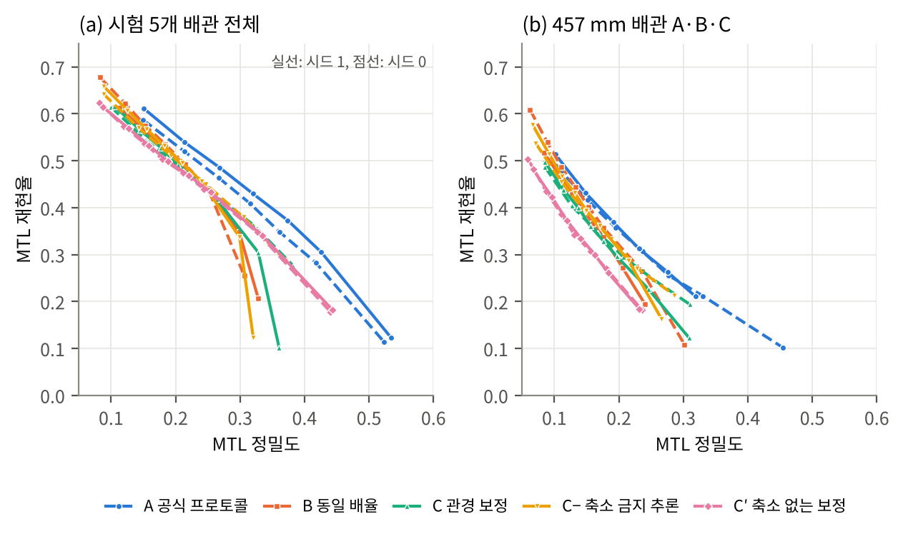
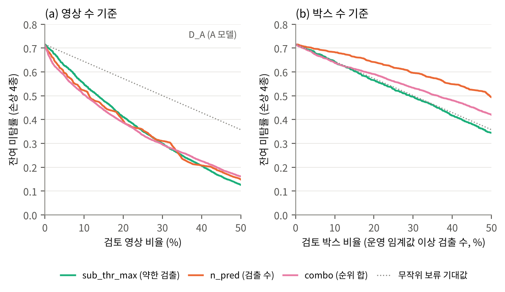
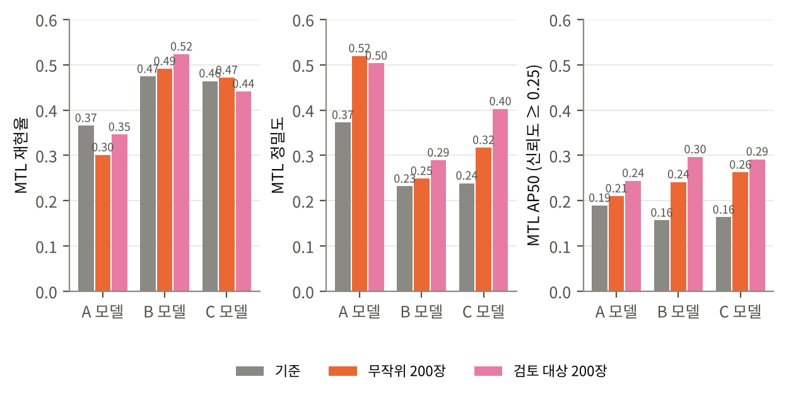

# 미관측 가스배관 MFL 결함탐지를 위한 사람–AI 협업 검사 절차
### 관경 보정의 검증과 판단보류–적응 루프 (PipeMFL-240K, YOLOv8s)

중앙대학교 발전기계학과 졸업논문 · 한국가스학회 제2회 수소·가스 산업 AI 활용 우수사례 경진대회(학부생 부문) 출품작의 재현 코드입니다.
영상 폴더·라벨 폴더·배관 메타데이터(공칭 외경)만 있으면 논문의 모든 표·그림을 다시 만들 수 있습니다.

**A Human–AI Collaborative Inspection Procedure for MFL Defect Detection on Unseen Gas Pipelines: Verifying Diameter Normalization and a Deferral–Adaptation Loop.** Reproduction code for an undergraduate thesis (Chung-Ang University) built on the public PipeMFL-240K dataset: pipeline-level splits, diameter-based input normalization (verified and rejected at matched precision), image-level selective deferral with a review budget, and a review-and-adapt loop.

## 한 줄 결론

추가 학습도 새 모델 구조도 없이, 탐지기 출력만으로 AI가 고른 영상 20%를 검사원이 보면 **어떤 모델에서든 잔여 미탐이 40–48% 줄고**(무작위 보류 대비 −12–19%p), 그 검토 결과(무작위의 3배 라벨)는 그대로 다음 적응 자료가 됩니다. 관경 기반 입력 보정은 비등방 왜곡을 제거하지만 **같은 정밀도에서는 공식 프로토콜 탐지기를 넘지 못했습니다.**

| 단계 | 내용 | 근거 |
|---|---|---|
| ① 입력 규칙 | 공식 프로토콜 탐지기(2,400 px 창 → 640) + 검증 배관에서 목표 정밀도에 맞춘 임계값 | 정밀도 0.30에서 재현율 A 0.43–0.45 > C 0.35–0.39 · C′ 0.38 · B 0.28–0.34 (표 5-5) |
| ② 검토 예산 판단보류 | 검출 수(n_pred) 또는 배관 안 순위 합(combo)으로 영상을 정렬, 예산만큼 검사원 검토 | 20% 검토 시 잔여 미탐 A 0.715→0.387, C 0.721→0.391 (무작위 0.57–0.58) (표 5-10) |
| ③ 검토–적응 루프 | 검토한 영상의 라벨(4,252–4,408개 vs 무작위 1,412개)로 5 에포크 적응 | 세 모델 모두 AP50 검토 대상 > 무작위 > 기준 (A 0.19→0.21→0.24, B 0.16→0.24→0.30, C 0.16→0.26→0.29) (표 5-11) |





## 저장소 구성

```
mfl_thesis/        실험 패키지 (python -m mfl_thesis.<module>)
  manifest.py        파일명 규칙으로 배관 ID·관경을 연결, 배관 단위 분할(학습/검증/시험/적응)
  geometry.py        관경 환산(s_y = πD/2,400), 배율, 타일 격자, 원주 순환 패딩, 역변환, NMS
  make_tiles.py      조건별 학습 타일 캐시(양성:빈 = 9:1)
  train_condition.py ultralytics 학습·미세조정 래퍼
  infer_images.py    즉석 보정·타일링·예측·병합 (조건 A/B/C/C′, 배율 고정, 순환 패딩 on/off)
  evaluate.py        클래스별 재현율·정밀도·AP50, mm 길이 구간 POD, 이음부, 쌍체 부트스트랩
  sweep_thresholds.py 임계값 스윕 → 같은 정밀도 비교
  deferral.py        판단보류 점수(sub_thr_max, n_pred, combo, ensemble, random), 외삽 항, Risk–Coverage, AUROC
  select_review.py   라벨 없이 검토 대상 n장/배관 선택 → 적응 매니페스트
  fp_analysis.py     오탐의 정답 근접도 분석
  viz_cases.py       미탐·오탐 사례 그림
  ch5_figs.py        논문 5장 그림 5-1~5-8
  demo.py            시연: 영상 한 장 + 관경 → 결함 상자(mm) + 검토 권고 (demo_check.py: 매니페스트에서 표본 실행)
  run_queue.py       큐 파일 순차 실행(완료 표시로 재개)
queues/            실제로 실행한 큐 파일 queue.txt ~ queue7.txt (총 GPU 약 70 h, RTX 2060 Super 8 GB)
scripts/           Windows PC 설정(setup.bat, cmd_here.bat), 데이터 내려받기, 결과 묶기
demo/              오프라인 대시보드 데모(demo.html)와 생성기(build_demo.py)
docs/              패키지 사용 안내(PACKAGE_GUIDE.md), 논문 그림
```

## 빠른 시작

```
pip install -r mfl_thesis/requirements.txt
pip install torch torchvision --index-url https://download.pytorch.org/whl/cu121   # GPU 환경에 맞게
pip install ultralytics
python -m mfl_thesis.selftest --work selftest_out        # 합성 자료로 좌표 변환·평가 일관성 확인 (5분)
```

실제 자료(PipeMFL-240K 시험 묶음, 약 110 GB; Hugging Face에서 `scripts/01_download_and_extract.py`로 내려받음)를 준비한 뒤:

```
python -m mfl_thesis.manifest --images data/test_data/test/images --labels data/test_data/test/labels --pipes pipes.csv ^
    --pattern "Test_([A-K])_" --test-pipes A,B,C,D,J --val-pipe F --adapt-n 200 --out manifest.csv
python -m mfl_thesis.run_queue queues/queue.txt      # 타일 캐시·학습 (이어서 queue2 … queue7)
```

큐 파일의 각 줄은 `완료표시 | 명령`이며, 중단 후 같은 명령으로 재개됩니다. 논문 표와의 대응은 `docs/PACKAGE_GUIDE.md`와 각 큐 파일의 주석에 있습니다.

### 시연 (영상 한 장)

```
python -m mfl_thesis.demo --image Test_A_0000468.png --diameter 457 --model runs/A_s1/weights/best.pt --out demo_out
```

결함 상자와 mm 크기, 검출 수·약한 검출 신뢰도의 시험 분포 대비 백분위, 검토 권고가 그림과 JSON으로 저장됩니다. `demo/demo.html`은 실험 산출물에서 만든 오프라인 대시보드(검토 예산 슬라이더, 같은 정밀도 비교, 루프)입니다.

## 데이터와 분할

PipeMFL-240K (Qu et al., KDD 2026) 시험 묶음 48,064장, 11개 배관. 배관 단위로 재분할하여 학습에 없던 관경(457 mm 배관 A·B·C, 508 mm 배관 D)과 새 배관(813 mm 배관 J)에서 평가합니다. 학습 E·G·H·I·K, 검증 F. 평가 영상 13,740장(시험 배관당 적응용 200장 제외).

## 인용

```
박지훈, 관경 보정의 검증과 판단보류–적응 루프를 이용한 미관측 가스배관 MFL 결함탐지의 사람–AI 협업 검사 절차, 중앙대학교 발전기계학과 졸업논문, 2026.
```

데이터셋: Qu, T. et al., "PipeMFL-240K: A Large-scale Dataset and Benchmark for Object Detection in Pipeline Magnetic Flux Leakage Imaging," Proc. KDD, 2026.

## 라이선스

코드는 MIT 라이선스입니다. 데이터셋은 원 제공자의 라이선스를 따릅니다.
